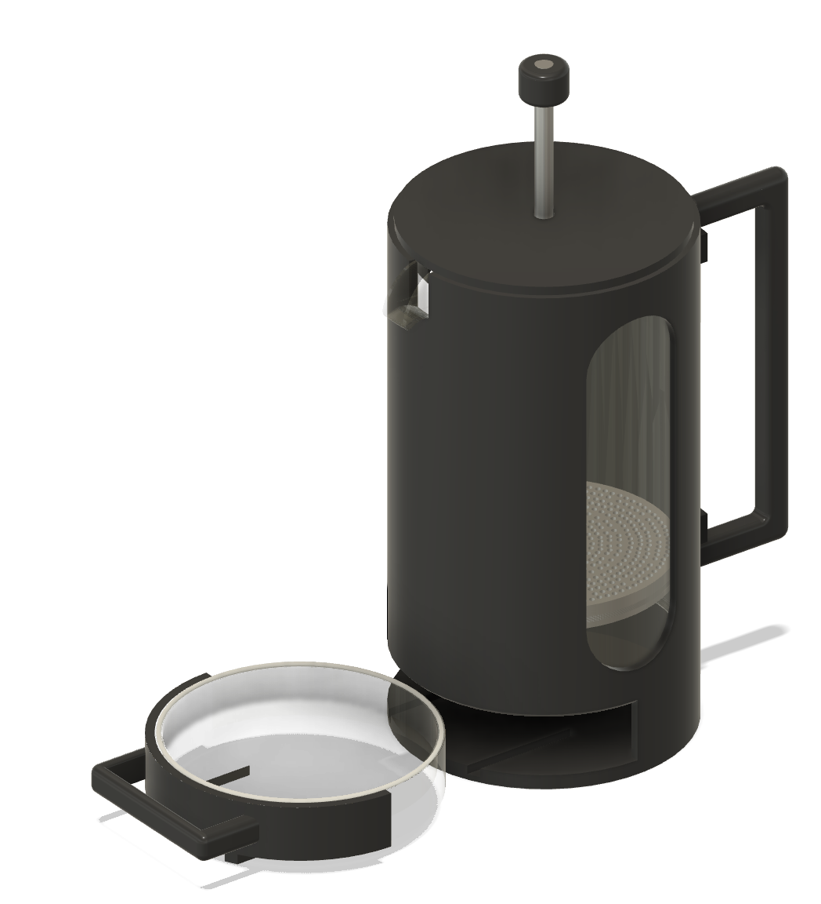
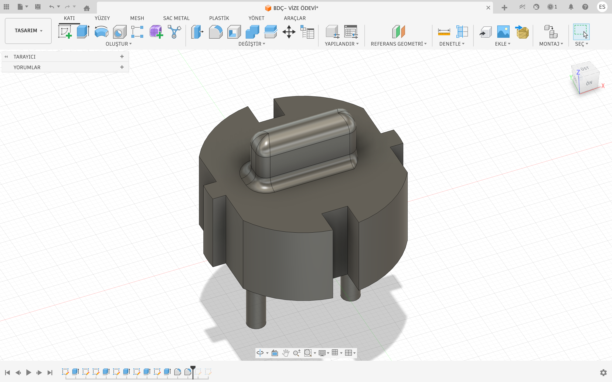
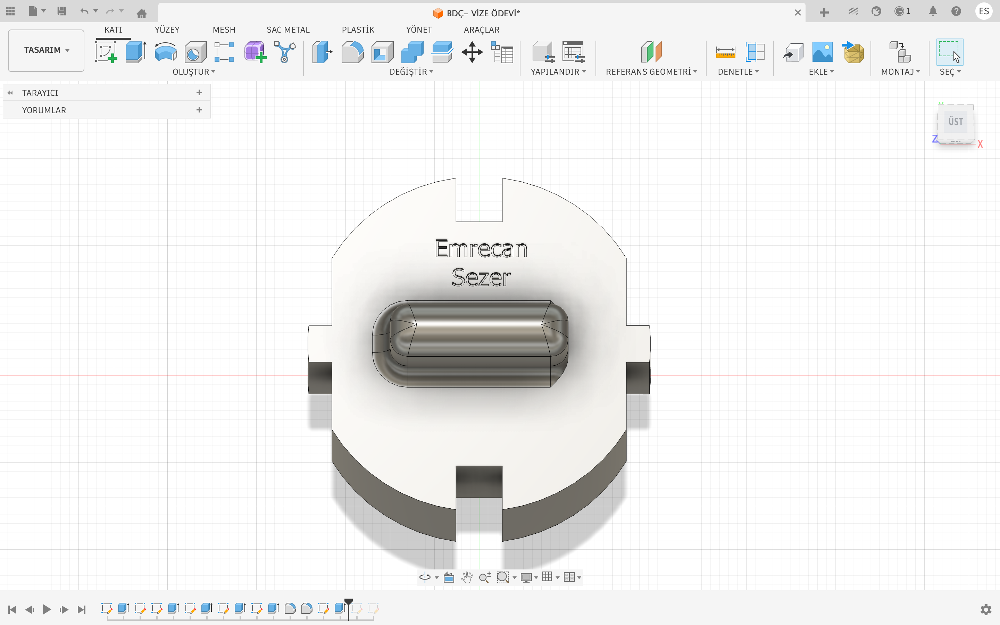

# Autodesk Fusion 360 - CAD Modelleme ve Montaj Projeleri

Bu depoda, üniversite dönem projesi ve vize/final ödevleri kapsamında Autodesk Fusion ile modellediğim 3D CAD çalışmalarım yer almaktadır.

---

## 1. Çok Parçalı French Press Modellemesi (Final Projesi)

Gövde, piston mekanizması ve hareketli parçalardan oluşan bir montaj (assembly) çalışmasıdır.

* **Montaj:** Parçalar `Joints` kullanılarak bir araya getirilmiş ve hareket serbestlikleri tanımlanmıştır.
* **Filtre Kısmı:** Filtre üzerindeki delikler `Circular Pattern` (dairesel çoğaltma) komutuyla oluşturulmuştur.
* **Alt Hazne:** Gövdenin altına raylı şekilde girip çıkan sürgülü bir çekmece/damlalık tasarlanmıştır.
* **Tasarım Dosyası:** [`French-Press-Assembly.f3d`](French-Press-Assembly.f3d)

### Görsel ve Animasyon

> Piston ve alt çekmecenin hareket animasyonu için depodaki [`French-Press-Mekanizmasi.mov`](French-Press-Mekanizmasi.mov) videosunu inceleyebilirsiniz.

---

## 2. F-Tipi Priz / Akım Koruma Parçası (Vize Projesi)

Mekanik arayüz ve taban parçası olarak tasarlanmış katı modelleme çalışmasıdır.

* **Çalışma Detayları:** Simetrik kanal kesimleri, geçiş radyusları ve skeç düzlemi üzerine metin kabartma (extrude) adımları uygulanmıştır.
* **Tasarım Dosyası:** [`Fusion-F-Tipi-Priz-Akim-Koruma-Aparati.f3d`](Fusion-F-Tipi-Priz-Akim-Koruma-Aparati.f3d)

### Çalışma Görselleri

| Ön / İzometrik Görünüş | Üst Görünüş |
| :---: | :---: |
|  |  |

---

## Dosyalar Hakkında
* **`.f3d` uzantılı dosyalar:** Autodesk Fusion'ın kendi çalışma dosyalarıdır. İndirilip doğrudan Fusion'da veya tarayıcı üzerinden [Autodesk Viewer](https://viewer.autodesk.com/) ile açılabilir.
* **`.png` ve `.mov` dosyaları:** Modellerin ve montaj hareketinin yazılım açılmadan görülebilmesi için eklenmiştir.
